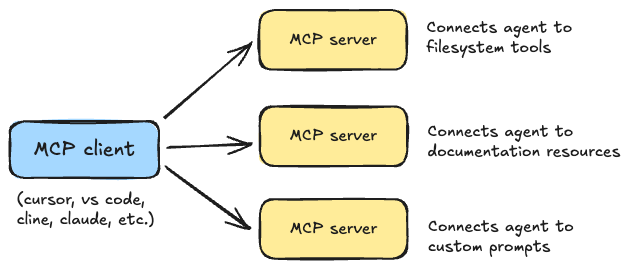

# MCP Server with OAuth 2.1 Authentication

This is a secure Model Context Protocol (MCP) server that implements OAuth 2.1 authentication using Scalekit as the authorization server. The server provides web search capabilities through the Tavily API while ensuring proper authentication and authorization.

## What is MCP?

MCP (Model Context Protocol) is a protocol designed for communication between LLMs and tools or resources. This implementation adds enterprise-grade security through OAuth 2.1 authentication, making it suitable for production deployments where access control is critical.



## Features

- **OAuth 2.1 Authentication**: Secure access using Scalekit authorization server
- **MCP Compliance**: Implements the MCP authorization specification
- **Web Search**: Provides web search functionality via Tavily API
- **Dynamic Client Registration**: Supports automatic client registration
- **Token Validation**: Validates access tokens with proper audience checking
- **Security Best Practices**: Implements PKCE, proper error handling, and token audience validation 

## Prerequisites

1. **Scalekit Account**: Sign up at [Scalekit](https://app.scalekit.com/ws/signup)
2. **Tavily API Key**: Get your API key from [Tavily](https://tavily.com)
3. **Python 3.11+**: Required for running the server

## Setup

### 1. Install Dependencies

```bash
pip install -e .
```

### 2. Configure Environment Variables

Copy the example environment file and configure your settings:

```bash
cp .env.example .env
```

Edit `.env` with your actual values:

```env
# Your Scalekit environment URL
SCALEKIT_ENVIRONMENT_URL=https://your-company.scalekit.com

# Your MCP server's resource identifier
RESOURCE_IDENTIFIER=https://your-mcp-server.com

# Server port (optional)
PORT=10000

# Tavily API key
TAVILY_API_KEY=your_tavily_api_key_here
```

### 3. Configure Scalekit

In the Scalekit dashboard:

1. Navigate to **MCP servers** and click **Add MCP server**
2. Configure your server:
   - **Server name**: "Web Search MCP Server"
   - **Resource identifier**: Your server URL (e.g., `https://your-mcp-server.com`)
   - **Allow dynamic client registration**: Enable this
   - **Access token lifetime**: 300-3600 seconds
   - **Scopes**: `web-search:read`, `web-search:write`

## Running the Server

```bash
python src/server.py
```

The server will start on `http://localhost:10000` (or your configured port).

## API Endpoints

### OAuth Discovery Endpoints

- `GET /.well-known/oauth-protected-resource` - Resource metadata for MCP client discovery
- `GET /.well-known/oauth-authorization-server` - Authorization server metadata (proxied from Scalekit)

### OAuth Endpoints

- `POST /oauth/register` - Dynamic client registration (proxied to Scalekit)

### MCP Endpoints

- `POST /web-search/mcp` - Main MCP endpoint (requires authentication)

## Authentication Flow

1. **Discovery**: MCP client discovers authorization server via `/.well-known/oauth-protected-resource`
2. **Registration**: Client registers with authorization server (if using dynamic registration)
3. **Authorization**: User authorizes the client through OAuth 2.1 flow
4. **Token Usage**: Client includes access token in `Authorization: Bearer <token>` header
5. **Validation**: Server validates token with Scalekit and checks audience

## Error Handling

The server returns proper HTTP status codes and WWW-Authenticate headers:

- `401 Unauthorized`: Missing or invalid token
- `403 Forbidden`: Valid token but insufficient permissions
- `503 Service Unavailable`: Unable to validate token with authorization server

## Security Features

- **Token Audience Validation**: Ensures tokens are issued specifically for this server
- **PKCE Support**: Protects against authorization code interception
- **Proper Error Responses**: Returns WWW-Authenticate headers as required by MCP spec
- **Scope-based Authorization**: Controls access to specific functionality

## Troubleshooting

### Common Issues

1. **Client Registration Fails**
   - Check that `SCALEKIT_ENVIRONMENT_URL` is correct
   - Ensure dynamic client registration is enabled in Scalekit dashboard
   - Verify network connectivity to Scalekit

2. **Token Validation Fails**
   - Check that `RESOURCE_IDENTIFIER` matches what's configured in Scalekit
   - Ensure the token was issued for the correct audience
   - Verify token hasn't expired

3. **Web Search Not Working**
   - Check that `TAVILY_API_KEY` is set correctly
   - Verify Tavily API key is valid and has sufficient quota

### Debug Mode

For debugging, you can add logging to see detailed error messages:

```python
import logging
logging.basicConfig(level=logging.DEBUG)
```

## Project Structure

```
src/
├── server.py          # Main FastAPI server with OAuth middleware
├── tavily_mcp.py      # MCP server implementation with Tavily integration
├── utils.py           # Token validation utilities
├── auth-mcp.md        # MCP authorization specification
└── upscalekit-docs.md # Scalekit integration documentation
```

## Key Implementation Details

This implementation addresses the main issues you were facing:

1. **Fixed OAuth Endpoints**: 
   - Corrected the protected resource metadata endpoint to `/.well-known/oauth-protected-resource`
   - Added proper dynamic client registration endpoint at `/oauth/register`
   - Fixed authorization server metadata proxying

2. **Proper Error Handling**:
   - Returns WWW-Authenticate headers as required by MCP specification
   - Provides detailed error messages for debugging
   - Handles different error scenarios appropriately

3. **Token Validation**:
   - Validates tokens with Scalekit's introspection endpoint
   - Checks audience claims to ensure tokens are for this specific server
   - Handles token validation errors gracefully

4. **Security Compliance**:
   - Implements OAuth 2.1 best practices
   - Supports PKCE for authorization code protection
   - Validates resource parameters as required by MCP spec

The server is now fully compliant with the MCP authorization specification and should work properly with MCP clients that support OAuth 2.1 authentication.